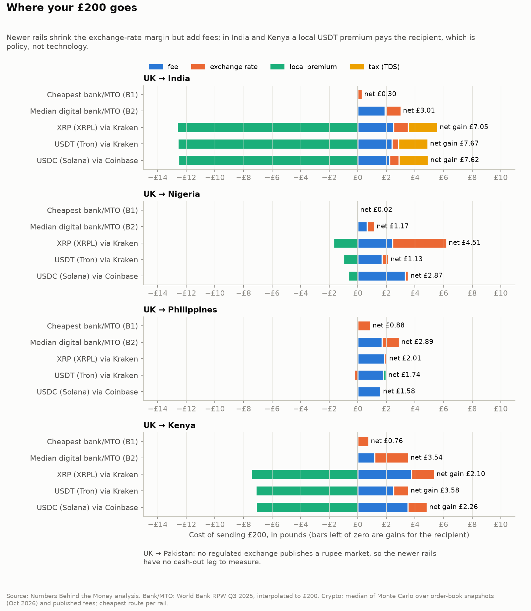
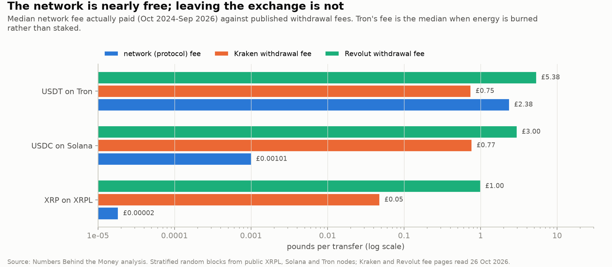
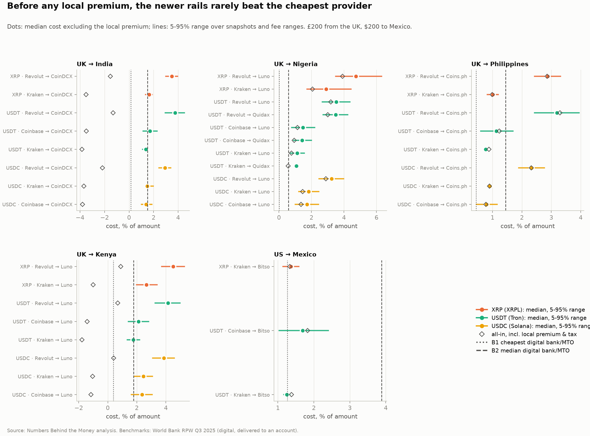
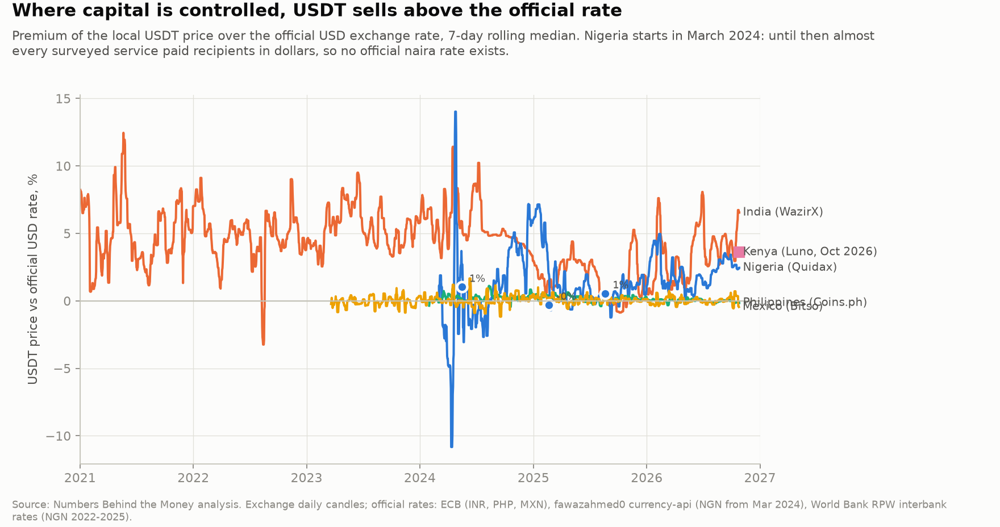
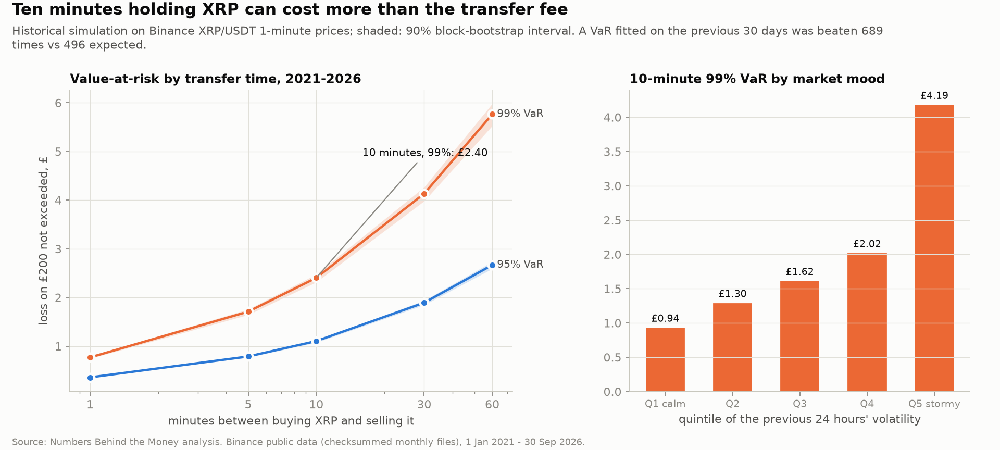

# New rails, old margins?

*Does crypto remove the hidden cost of sending money home, or just move it?*

**Draft, 26 October 2026.** The order-book numbers come from the first four hours (24 snapshots) of a 72-hour collection; they will be refreshed when it finishes.

---

In my last post I found that the exchange rate has quietly become the biggest part of what it costs to send money from the UK. Upfront fees have more than halved since 2011, but the margin hidden in the rate hasn't moved, and it now makes up **54% of the total**.

The obvious follow-up is the one crypto keeps promising to answer. If you send dollars-on-a-blockchain instead of pounds-through-a-bank, does that hidden margin disappear?

I tested a £200 transfer from the UK to India, Nigeria, the Philippines, Kenya and Pakistan (plus $200 from the US to Mexico as a check). I compared the banks and transfer firms in the World Bank's data with three newer rails: XRP on the XRP Ledger, USDT on Tron and USDC on Solana.

## The short version

The margin mostly does disappear. The cost doesn't. It moves into fees, into a price you can't control, and in two countries into a local quirk that has more to do with capital controls than technology.

## Where did the exchange-rate margin go?

A crypto transfer means buying the coin with pounds on a UK exchange, sending it on-chain, then selling it for local currency on an exchange at the other end and withdrawing it. Each step has a price. I measured spreads from live order books every ten minutes and took fees from published schedules.

On the busy markets, the exchange-rate part is tiny. On Kraken, the gap between buying and selling USDT with pounds was about **0.01%**. Selling USDT for pesos on Coins.ph cost about the same. Across every route I tested, the median share of the cost sitting in exchange rates was **17%**, against 54% for the average UK money transfer.

That's where the good news stops, because the cost reappears as fees:

- **Trading fees at both ends.** Kraken charges 0.2% to buy a stablecoin and up to 0.8% for XRP. Local exchanges charge roughly 0.25–0.8% to sell.
- **Withdrawal fees.** Kraken charges 1 USDT (about 75p) to send USDT on Tron and £0.77 to send USDC on Solana. Revolut charges a flat £3 to withdraw a stablecoin. On £200, that is 1.5% before anything else.

The fees on the blockchain itself are not the problem. The median network fee I measured over the last two years was about **£0.00002** for an XRP payment and **£0.001** for a USDC transfer on Solana. Kraken's withdrawal fee for USDC is roughly **760 times** what the network actually charges.

Tron is the exception. Sending USDT there burns about **£2.38** of TRX in network fees unless the sender has staked the token or rented "energy" in advance. Most exchanges do that for you; an individual sending from their own wallet usually doesn't.

So the margin is mostly gone, replaced by flat fees, which hurt small transfers most.

## Do the newer rails beat the cheapest provider?

This is the comparison that matters, because nobody should compare crypto with the average. The cheapest digital services in the World Bank's survey, scaled to £200, are remarkably cheap. One costs 0.15% to India (State Bank of India, if you bank with them at both ends), 0.44% to the Philippines, and 0.38% to Kenya.

Set aside any local premium (more on that below), and the best crypto route in each corridor costs:

| Corridor | Best crypto route | Cheapest provider | Median digital provider |
|---|---|---|---|
| UK → India | 1.37% (USDT) | 0.15% | 1.50% |
| UK → Nigeria | 1.07% (USDT) | 0.01% | 0.58% |
| UK → Philippines | 0.77% (USDT) | 0.44% | 1.44% |
| UK → Kenya | 1.75% (USDT) | 0.38% | 1.77% |

Across thousands of simulated combinations of snapshot and fee, the best crypto route beat the cheapest provider at most 4% of the time (to the Philippines), and never in the other three corridors. Against the median digital provider it's closer. It wins to the Philippines and, narrowly, to India, about half the time to Kenya, and never to Nigeria.

The rail itself just isn't cheap enough. Good transfer firms already sit at 0.2–0.5%, and two exchange fees plus a withdrawal fee rarely come in under that.

## The local premium

In India and Kenya the full picture looks very different. The recipient seems to come out *ahead*, by about £7.70 on £200 in India and £3.60 in Kenya.

That is not the rail. It's the price of USDT in those countries. On the day I measured, USDT sold on CoinDCX for about **6.3% more** rupees than the official dollar rate gives. On Luno in Kenya it was about **3.6% more**. In the Philippines and Mexico, where there is no such premium, the price was within a fraction of a percent of the official rate.

The history shows this isn't a one-off. WazirX's USDT price sat a median of about 5% above the official rate in every year from 2021 to 2024. Nigeria's swung from about −15% to +17% in 2024 while the naira was floated, and has mostly stayed within a few percent since. Before that, I couldn't measure it at all, for a reason I didn't expect: until early 2024, almost every service in the World Bank's survey paid Nigerian recipients in **US dollars**, not naira.

A premium like this exists because moving money in and out of the country is restricted or taxed. In India the recipient's exchange deducts 1% tax at source, gains are taxed at 30%, and receiving a remittance this way sits outside the usual regulated channels. I'd treat the premium as a sign of the controls, not as a saving.

## What about speed and risk?

The blockchains are fast. In my live samples an XRP Ledger closed every **4 seconds** and Solana confirmed in about **0.2 seconds**, after a big upgrade to its consensus five days earlier. Tron took about **57 seconds** to make a payment irreversible.

But 57–85% of the bank and transfer-firm services in the World Bank's data already deliver in under an hour. The slow parts of a crypto transfer happen off the ledger: verifying your identity on two exchanges, withdrawal processing, and, if you've never bought crypto in the UK, the FCA's 24-hour cooling-off period.

Risk is where XRP struggles. Over ten minutes, the time it might take to move it between exchanges, XRP's price fell by more than 1.2% in 1% of all ten-minute windows since 2021. That's a **£2.40** loss on £200. In the most volatile fifth of periods it was **£4.19**. That is bigger than the whole fee for most of the transfer firms above.

Stablecoins remove most of that risk. USDC and USDT were within 0.5% of a dollar in **99.8%** of hours. But "most" is doing some work: during the Silicon Valley Bank collapse in March 2023, USDC traded as low as **$0.81**.

## What it means if you're sending money home

- **If you already use a cheap online transfer firm, you're probably paying less than the newer rails would cost you.** The cheapest providers in these corridors beat every crypto route I modelled.
- **Watch flat fees.** A £3 withdrawal fee is 1.5% of £200 but only 0.3% of £1,000. The newer rails look better the more you send.
- **A "better rate" in crypto is often a premium that exists because of capital controls.** It can disappear, and it comes with tax and legal questions for the person receiving it.
- **Pakistan is a reminder that the last mile matters.** No regulated exchange publishes a rupee market I could measure, so for now the newer rails there have no measurable way to cash out.

## How I did this, and what the data can't tell us

- **Traditional rails:** World Bank Remittance Prices Worldwide, Q3 2025 (my code reproduces its 6.36% global average), interpolated to £200 for each service and cross-checked against same-day quotes from Wise's comparison tool.
- **Newer rails:** order books from eight exchanges every ten minutes, published fees recorded as ranges, and on-chain fees and timings from public XRP Ledger, Solana and Tron nodes.
- **Uncertainty:** costs are a Monte Carlo over snapshots and fee ranges, and risk uses block-bootstrap intervals. I wrote down six hypotheses before running anything. Five held. The one that failed: XRP's price risk exceeded its saving in only two corridors, and those savings existed only because of the local premium.
- **Limits:** these prices assume accounts on two exchanges already exist, and ignore identity checks, availability and tax. Some local fees came only from secondary sources, so I used wide ranges, and the order books cover days, not seasons. The full list is in [LIMITATIONS.md](../LIMITATIONS.md).

All the code and data are on GitHub: [github.com/CodingWithIsh/New-rails-old-margins](https://github.com/CodingWithIsh/New-rails-old-margins). This is analysis of public data, not financial advice, and not a recommendation to buy any token.

## What's next

Last time I promised a look at which providers are consistently cheapest. The benchmark here is part of that answer, since crypto has to beat the cheapest provider and not the average. Next I'll follow those cheapest providers over time.

If you send money abroad, I'd like to know which route you use and what you pay.

*- Ismail*
